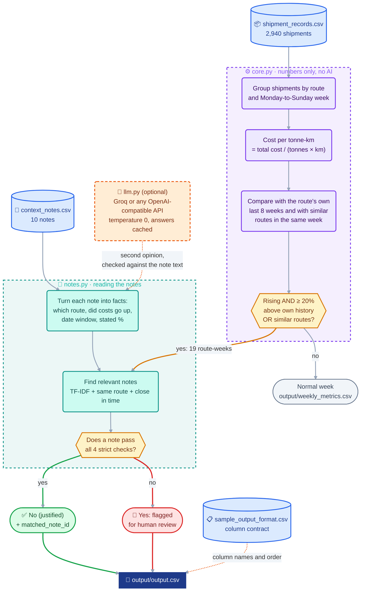
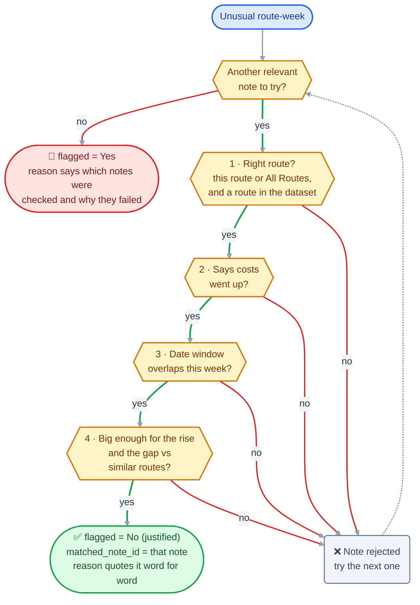

# Shipping Cost Watcher

Finds routes whose cost per tonne-km is rising in a way that looks out of the ordinary, then checks the context notes before raising a flag. A rise is excused only when a note genuinely explains it; every verdict says which note it used or why the nearby notes did not count.

## Architecture



No database, no server and no network needed: one command reads the CSV files and writes CSV/JSON files. Every number, comparison and flag is plain pandas; the LLM is optional, only helps read the notes, and is never trusted without checking its answer against the note text.

| File | Role |
|---|---|
| `assistant.py` | Command-line entry point (`run`, `repro`, `ask`). Wires the steps together, writes the output files and checks the result against the sample rows. |
| `core.py` | Loads the shipments, computes weekly cost per tonne-km, both comparisons and the anomaly test. |
| `notes.py` | Turns each note into checkable facts, finds the relevant notes and decides every verdict with strict rules. |
| `llm.py` | Optional LLM client: any OpenAI-compatible API (Groq by default), temperature 0, answers cached on disk, token log. |
| `qa.py` | The `ask` command: code picks the evidence (weekly numbers, verdicts, notes), then the answer is built only from it. |
| `eval.py` | Hand-labelled test set plus guardrail tests that rerun the assistant on deliberately altered notes. |

## Run it

```bash
pip install -r requirements.txt
# put shipment_records.csv, context_notes.csv, sample_output_format.csv in data/
python assistant.py run          # -> output/output.csv (+ output/weekly_metrics.csv, output/note_facts.json, token_log.md)
python assistant.py repro        # 3 separate runs, compared byte for byte -> repro/repro_check.md
python assistant.py ask "why did Chennai-Bangalore get pricier in March 2025?"
python eval.py                   # labelled set + guardrail tests -> eval_report.md
python demo.py                   # guided walkthrough of every step (press Enter between steps)
```

Works fully offline. To switch on the LLM layer, set `LLM_API_KEY` (Groq free tier, open-source `llama-3.1-8b-instant` by default; any OpenAI-compatible endpoint via `LLM_BASE_URL` / `LLM_MODEL`).

## How it works

Each step below is one part of the [Architecture](#architecture) diagram.

**1. Core numbers (`core.py`, no AI).**
- Route = `origin-destination`. Week = Monday to Sunday, labelled by its Monday.
- Weekly cost per tonne-km = total freight cost of the week's shipments / total (tonnes x km).
- `vs_own_history`: this week vs the simple average of the route's weekly values in the 8 calendar weeks strictly before it. Fewer than 8 prior weeks: use what exists (the number of weeks used is in `output/weekly_metrics.csv`, column `own_weeks_used`). No prior week (first week of data): left as `n/a`, never padded.
- `vs_similar_routes`: this week vs the simple average of the other routes with the same `route_type` in the same week; the route itself is excluded.

**2. Anomaly test.** A route-week is checked when it is **rising** (above its own trailing average) **and** out of the ordinary: at least **+20%** vs its own history **or** at least **+20%** vs similar routes. Why 20%: in weeks with no known event, the rise vs own history stays below +7% and the gap vs peers below +11% (99th percentiles); real events in this data sit at +21% to +39%. Results are stable between 15% and 25% for every route except the slowly drifting Mumbai-Pune, where the threshold only moves which weeks of an obvious drift get listed.

**3. Reading the notes (`notes.py`).** Each note becomes a small set of checkable facts: does it concern a route in this dataset, does it say costs went **up** (vs "not significantly affected", "absorbed", "returned to normal", "improved", "stable"), its time window (explicit dates like "Feb 24 to Mar 8", "this quarter", "starting this week" = open-ended, otherwise the note's week), and any stated magnitude ("5-7%"). The exact clause that decided this is kept as evidence.

**4. Retrieval.** For each anomaly, notes are ranked by TF-IDF similarity to the route and the idea of a cost rise, plus a same-route bonus and closeness in time. Only notes for this route or "All Routes" are considered.

**5. Strict verdict.** A note justifies the rise only if all of these hold, otherwise the row is flagged `Yes`:
1. it concerns a route in the dataset and this route (or all routes);
2. it says costs went up;
3. its window overlaps the flagged week;
4. it is big enough: a stated % range must cover both the rise vs the route's own history and its gap vs similar routes (+3 pts slack), and an all-routes note cannot explain one route jumping above its peers, because the peers had the same note.

How one flagged route-week is decided (the notes are tried in order of relevance; the first note that passes every check is cited):



The reason column quotes the note verbatim (never paraphrased by a model), so an explanation cannot contain a fact that is not in the notes.

## Where AI is used, and the guardrails

| Part | AI | Guardrail |
|---|---|---|
| Finding relevant notes | TF-IDF retrieval (local, deterministic) | hard filters on route and time before anything is used |
| Understanding a note | rules, plus an optional LLM second opinion at temperature 0 | the LLM's supporting quote must exist verbatim in the note; its numbers/dates must appear in the text; if it and the rules disagree on "costs went up", the cautious answer wins; an unreadable answer falls back to rules |
| Writing the explanation | template + verbatim quote | nothing invented; "No matching note found" when nothing qualifies |
| `ask` (stretch goal) | LLM answers from evidence selected by code | any note id it cites that is not in the evidence is called out |

The numbers, comparisons and flags never depend on an LLM.

## How I convinced myself it is right

- **The sample rows reproduce exactly.** All three example rows in `sample_output_format.csv` match to the last digit (`run` prints this check): Delhi-Jaipur 2024-11-11 `4.17 / +35.5% / +21.0%`, Ahmedabad-Mumbai 2025-01-20 `3.29 / +29.5% / +22.5%`, Mumbai-Pune 2025-09-15 `3.98 / +9.2% / +23.6%`. This confirms the weekly formula and both baseline definitions.
- **Hand check.** Delhi-Jaipur, week of 11 Nov 2024: shipments SHP01093-SHP01096 cost 84,388 INR for 20,222.6 tonne-km = 4.173.
- **Data checks.** 7 routes x 104 weeks, no missing weeks, at least 3 shipments per route-week, consistent route types.
- **Every trap note behaves.** N004 (routes not in the dataset), N005 (costs not significantly affected), N006 and N008 (stable / no disruptions), N007 (roads improved), N009 (back to normal), N010 (absorbed without a rate change) never justify anything. N001 justifies only the weeks inside Feb 24-Mar 8; N003's 5-7% cannot cover a 20%+ jump or a gap vs peers.
- **Labelled eval (`python eval.py`, report in `eval_report.md`): 18/18.** 9 route-weeks labelled by hand from the notes, the 3 sample rows, a citation-integrity check on every output row, and 5 guardrail tests that rerun the assistant on deliberately altered notes (note moved to another route, moved to the wrong week, rewritten to say costs were not affected, a 2% rise set against a 35% jump, and a genuine new note that must be accepted). A deliberately broken version that accepts any note scores 9/18, so the eval does catch mistakes.
- **Reproducibility.** `repro/repro_check.md`: three runs in separate processes are byte-for-byte identical.
- **LLM path tested** against a local mock API: same output as offline mode, second run served from cache (0 calls), fabricated note ids in `ask` answers are caught.

## What it found

19 route-weeks tripped the test: **3 justified, 16 flagged**.
- **Ahmedabad-Mumbai, week of 20 Jan 2025** (+29.5%): festival-week surcharge, N002. Justified.
- **Chennai-Bangalore, weeks of 24 Feb and 3 Mar 2025** (+23% to +32%): flooding Feb 24-Mar 8, N001. Justified.
- **Chennai-Bangalore, weeks of 10 and 17 Mar 2025**: still about 33% above other Medium routes after the flood window ended (roads passable from Mar 9, N009 says conditions are normal). **Flagged** - the note does not cover these weeks.
- **Delhi-Jaipur, weeks of 11 and 18 Nov 2024** (+35.5%, +27.6% vs own history): no note. **Flagged**.
- **Mumbai-Pune, 12 weeks from June 2025**: a slow creep from about 3.3 to 4.5 INR per tonne-km over two years. Week to week it never looks unusual against its own history (+3% to +9%), but it runs 20-39% above Delhi-Jaipur. Only the peer comparison catches it. **Flagged**.
- The nationwide diesel rise (N003) shows up in the data as a ~5% step across all routes from the week of 5 May 2025; it stays below the thresholds (largest: Mumbai-Delhi +11.6%), so it correctly creates no flags.

All route-weeks with both comparisons are in `output/weekly_metrics.csv`; the parsed note facts are in `output/note_facts.json`.

## Cost

See `token_log.md`. Offline mode: 0 LLM calls, $0. LLM mode: one call per context note (10 calls, a few thousand tokens, fractions of a cent on the published rate, $0 on the free tier); repeat runs hit the cache and make 0 calls. Cost depends on the number of notes, not the number of shipments.

## Assumptions

- The output lists every route-week that tripped the test (`Yes` or `No (justified)`); normal weeks are in `weekly_metrics.csv`.
- The wording after the % in `vs_own_history` / `vs_similar_routes` is copied from `sample_output_format.csv`; column names are taken from that file automatically.
- A note's explicit dates take the note's year. Thresholds and slack are in `CONFIG` in `assistant.py`.
